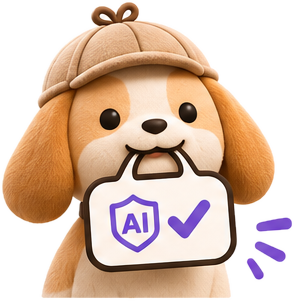
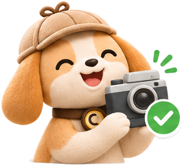

<p align="center">
  Open-source AI detection for <strong>text, images, voice and video</strong>, on the web and on WhatsApp.
</p>

<p align="center">
  <a href="#quick-start-docker">Quick start</a> ·
  <a href="#how-it-works">How it works</a> ·
  <a href="#whatsapp">WhatsApp</a> ·
  <a href="#configuration">Configuration</a> ·
  <a href="#contributing">Contributing</a>
</p>

Send Sniff a paragraph, a photo, a voice note or a clip. It answers in plain words, shows the evidence behind the answer, and says "can't tell" when it honestly can't.

> Verdicts are automated estimates, not proof. Please don't use them as the only evidence against anyone.

## Meet Sherlock

Sniff's mascot is **Sherlock**, a beagle in a detective cap. Beagles are real detection dogs (airports use them), and Sherlock doesn't guess: when he isn't sure, he tilts his head. Every check ends in one of four verdicts, and Sherlock wears a face for each one, in the app and in every reply.

|  |  |  |  |
| :-: | :-: | :-: | :-: |
| **Likely AI** | **Inconclusive** | **No AI signal found** | **Declared AI** |
| The detectors agree AI made it. | The signals are mixed or weak. Sniff gives its best guess and says so. | Nothing points to AI. This isn't a guarantee that a human made it. | The file carries its own AI label: Content Credentials (C2PA), an invisible watermark or generator metadata. |

He has a few more moves: sniffing while a check runs, a camera when a photo carries proof it's a real capture, and a sad sit when he loses the scent.

<p align="center">
  
  
  
</p>

## Why Sniff

- **Evidence first.** Provenance (C2PA, IPTC, generator metadata) and invisible watermarks (Stable Diffusion, Meta AudioSeal) decide when present. Otherwise calibrated detectors vote, with an honest _inconclusive_ band.
- **Runs on your machine.** Every detector model runs locally. No API key and no cloud upload are needed for a verdict.
- **Code decides, AI explains.** The detector writes the verdict. An optional language model (Muse, via the Meta Model API) only explains it in friendly words and answers follow-up questions, so it can't change the answer. Without a key, Sniff uses built-in template replies.
- **Web and WhatsApp.** The same pipeline answers both, and every check is saved to your history.

## Quick start (Docker)

You need [Docker](https://docs.docker.com/get-docker/) with Compose and about **10 GB of free disk space** for models.

```bash
git clone https://github.com/rishil-sh/ai-detection-suite.git sniff && cd sniff
docker compose up
```

Open **http://localhost:3001** and create an account. Accounts live in your local database; nothing is sent anywhere.

The first start downloads the detector models (~10 GB) into the `models` Docker volume, so it takes a while. Later starts take seconds. The images contain no model weights. To fetch models ahead of time, or again after changing model settings, run `docker compose run --rm models`.

| Service | URL | What |
| --- | --- | --- |
| `web` | http://localhost:3001 | Web app: Check (chat) and History |
| `server` | http://localhost:3000 | API, auth, reply agent, WhatsApp webhook |
| `detector` | internal `:7860` | Python detector (not exposed to the host) |
| `models` | runs once | Downloads models, then exits |

Data lives in two volumes: `models` (weights) and `data` (SQLite databases and the generated auth secret). `docker compose down -v` deletes both.

## Configuration

Everything is optional. Copy [.env.example](.env.example) to `.env` next to `docker-compose.yml` and fill in only what you need. Each variable is explained inline in that file.

| Setting | Default | What it does |
| --- | --- | --- |
| `MODEL_API_KEY` | empty | Muse (Meta Model API) key for friendly replies and follow-up questions. Get one at [dev.meta.ai](https://dev.meta.ai). Without it, verdicts are the same and replies use templates. |
| `MUSE_MODEL` | `muse-wonder-1.0` | Reply model. `muse-spark-1.3` is faster and cheaper. |
| `AI_DETECTOR_TEXT_PAIR` | `0` | Set it to `1` to add the Llama-3.2-3B zero-shot text evidence. This needs ~13 GB more disk and Docker memory of at least 16 GB. |
| `HF_TOKEN` | empty | Hugging Face token, only for gated models such as `meta-llama/Llama-3.1-8B`. |
| `PUBLIC_SERVER_URL`, `PUBLIC_WEB_URL` | localhost | Your public URLs when Sniff isn't on localhost. Rebuild with `docker compose up --build` after changing them. |
| `BETTER_AUTH_SECRET` | generated | Session signing secret. One is generated on first boot and kept in the `data` volume. |
| `ADMIN_EMAILS` | empty | Comma-separated emails that may see WhatsApp checks in the web History. |
| `WHATSAPP_*` | empty | Connects a WhatsApp number (see [WhatsApp](#whatsapp)). |

For local development, each app has its own `.env.example`:

- [apps/server/.env.example](apps/server/.env.example): API URLs, database paths, the Muse key and WhatsApp.
- [apps/web/.env.example](apps/web/.env.example): the API URL the browser calls.
- [apps/detector/.env.example](apps/detector/.env.example): model choices, the model cache path and the Hugging Face token.

## How it works

```
web (Next.js :3001) ──oRPC──┐
                            ├─► server (Hono :3000) ──► detector (FastAPI :7860) → verdict + evidence
WhatsApp ─► /webhooks/whatsapp┘       ├─ Mastra agent (Muse) → plain-words reply
                                      └─ SQLite: accounts, history, agent memory
```

| Input | Evidence |
| --- | --- |
| **Image** | C2PA / IPTC credentials, generator metadata (AUTOMATIC1111, ComfyUI and others), the SD/SDXL invisible watermark, and the Community Forensics and Cozzolino CLIP detectors |
| **Voice** | Meta AudioSeal watermark and a w2v-BERT 2.0 probe (these decide), plus DF Arena and XLSR-MamBo (supporting) |
| **Video** | Provenance, plus 16 frames sampled across the clip and scored by the image detector. The soundtrack goes through the voice checks, and the results are combined. |
| **Text** | The Fakespot RoBERTa and Desklib DeBERTa classifiers (these decide), plus Binoculars, Fast-DetectGPT and GLTR on a Llama-3.2-3B pair (supporting, optional) |

**Limits:** text must be English and about 110 words or more. Shorter or non-English text gets a "couldn't check this" reply instead of a guess. Voice files are capped at 32 MB. Re-encoded, cropped or screenshotted media lose their watermarks and credentials, and that is when the detectors have to do the work.

Calibration, thresholds and measured accuracy are in [apps/detector/README.md](apps/detector/README.md).

## Development

You need Node.js 24+, [pnpm](https://pnpm.io), [Bun](https://bun.sh), [uv](https://docs.astral.sh/uv/) and Python 3.11. ffmpeg is bundled with the detector through `imageio-ffmpeg`.

```bash
pnpm bootstrap   # creates the .env files (with an auth secret), installs JS + Python deps, migrates the database
pnpm models      # optional: download models now (into apps/detector/data/models) instead of on first use
pnpm dev         # web :3001 · API :3000 · detector :7860
```

Locally the Llama text pair is **on** by default (~13 GB download and RAM). Set `AI_DETECTOR_TEXT_PAIR=0` in `apps/detector/.env` to skip it.

| Command | What it does |
| --- | --- |
| `pnpm check` / `pnpm fix` | Lint and format (Ultracite: oxlint + oxfmt) |
| `pnpm check-types` | TypeScript across all workspaces |
| `pnpm test` | Detector (pytest) and server (bun) tests. The tests stub the models, so no downloads. |
| `pnpm db:generate` / `pnpm db:migrate` | Create a migration from the schema / apply migrations |
| `pnpm db:studio` | Browse the database |

Brand assets live in [docs/brand](docs/brand) (the brand board, sticker set, banner and WhatsApp profile picture) and [apps/web/public/brand](apps/web/public/brand) (Sherlock's poses and faces, and the app icons).

Local files that git ignores: `.data/` (SQLite databases) and `apps/detector/data/` (models and eval sets).

### Repository layout

| Path | What it is |
| --- | --- |
| [apps/detector](apps/detector) | Python detector (FastAPI, PyTorch), a uv project. It can also be used on its own. |
| [apps/server](apps/server) | API: Hono + oRPC + better-auth on Bun, the Mastra reply agent and the WhatsApp webhook |
| [apps/web](apps/web) | Next.js web app: Check (chat) and History |
| [packages/api](packages/api) | oRPC routers and shared types |
| [packages/auth](packages/auth) | better-auth configuration |
| [packages/db](packages/db) | Drizzle schema and migrations (SQLite / libSQL) |
| [packages/ui](packages/ui) | Shared shadcn/ui components and theme |
| [packages/infra](packages/infra) | Optional Cloudflare deployment of the web app (Alchemy) |

## WhatsApp

1. Create a Meta app at [developers.facebook.com](https://developers.facebook.com) and add the **WhatsApp** product.
2. Fill in the four `WHATSAPP_*` values in `.env` (Docker) or `apps/server/.env` (local). [.env.example](.env.example) says where to find each one.
3. Expose the server over HTTPS, for example with `cloudflared tunnel --url http://localhost:3000`. Then set the webhook URL to `https://<host>/webhooks/whatsapp` with the same verify token, and subscribe to `messages`.
4. Send the number a photo, a voice note, a video or a paragraph of text.

WhatsApp users don't have a web login. To see their checks in the web History, add your email to `ADMIN_EMAILS`.

## Deploying

- **Docker (recommended):** `docker compose up -d` on any host with ~10 GB of disk. Put it behind HTTPS and set `PUBLIC_SERVER_URL` and `PUBLIC_WEB_URL`.
- **Web app on Cloudflare (optional):** [packages/infra](packages/infra) deploys `apps/web` to Cloudflare Workers with [Alchemy](https://alchemy.run). Run `cd packages/infra && pnpm exec alchemy profile edit`, then `pnpm deploy`. The server and detector still run wherever Docker does.

## Privacy

- Detection runs entirely on your machine.
- The content you check is never sent to Muse. The reply agent sees only the verdict and its evidence summary. Chat messages that aren't checks, such as follow-up questions, are sent to Muse when a key is set.
- With `MODEL_API_KEY` unset, Sniff makes no outside calls except to download models.
- Checks are stored in your local SQLite database so they show up in History.

## Contributing

Issues and pull requests are welcome. Before opening a PR, run `pnpm check`, `pnpm check-types` and `pnpm test`. CI runs the same checks. New detectors belong in [apps/detector/ai_detector/detectors](apps/detector/ai_detector/detectors) and their weights in [fusion.yaml](apps/detector/ai_detector/fusion.yaml). Please include measured accuracy on a held-out set.

## License

Sniff's code is [MIT](LICENSE) licensed. The detector models it downloads keep their own licenses. Check each model's page on Hugging Face before using it commercially.

## Acknowledgements

Sniff stands on open research and open weights: Community Forensics, Cozzolino et al.'s CLIP-based detector, Meta AudioSeal, w2v-BERT 2.0, DF Arena, XLSR-MamBo, Fakespot, Desklib, Binoculars, Fast-DetectGPT, GLTR and the C2PA project. Replies are powered by Muse through the Meta Model API. Sniff was built for the Meta Global AI Developer Hackathon.
