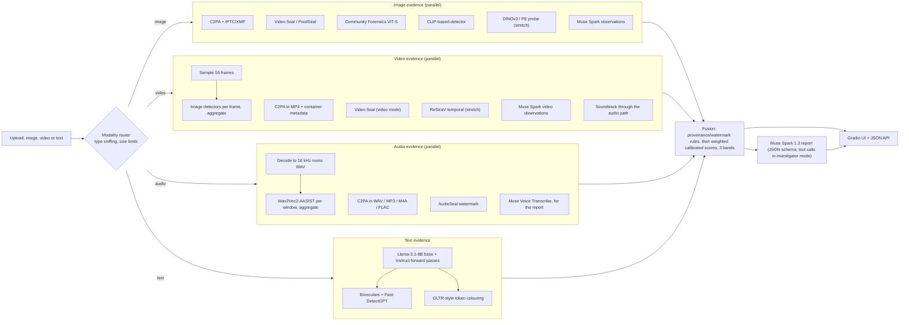

# Open-source AI-content detector: build guide for the Meta Global AI Developer Hackathon

_Prepared 2026-10-27; the audio sections were added the same day. Every fact that depends on a version, price or license was checked against the cited page on 2026-10-27. [n] refers to the numbered list in section 12. "Unverified" marks claims I could not confirm._

**The idea:** one open-source tool that runs detectors from published research behind a single interface. For an image, a video, an audio clip or a piece of text, it returns a verdict on whether the content is AI-generated, together with the evidence behind that verdict.

---

## 1. TL;DR

- **Output:** a _calibrated_ probability that the content is AI-generated, reported in three bands: **likely AI**, **inconclusive** or **no AI signal found**. When provenance metadata or a watermark says the content is AI, the verdict is **declared AI** instead. Every verdict comes with its evidence.
- **Provenance first:** read C2PA manifests (c2pa-python [80]) and the IPTC `trainedAlgorithmicMedia` tag [81], then check for invisible watermarks with Meta's open-source Video Seal / PixelSeal (MIT) [27].
- **Images:** use the **Community Forensics** ViT-S detector (MIT weights; works on day one) [60] plus the CLIP-based detector from Cozzolino et al. (Apache-2.0) [58]. Stretch goal: a linear probe trained on frozen **DINOv3 or Perception Encoder** features [34][35][64–66].
- **Video:** sample 16 frames, run the image detectors on each, and aggregate. Add the Video Seal check, C2PA and Muse Spark's video observations. Stretch goal: **ReStraV**, a temporal detector built on DINOv2 features [73].
- **Audio (speech):** read C2PA, which also works in WAV, MP3, M4A and FLAC files [87], and check for Meta's **AudioSeal** watermark (MIT, code and weights) [28]. Then run **Wav2Vec2-AASIST** (MIT), a published detector built on Meta's **XLS-R** speech model, over short windows [88][89]. **Muse Voice Transcribe** supplies the transcript for the report [90]. Treat audio verdicts as advisory, because open audio detectors break down on real-world clips [91][92]. Music is out of scope.
- **Text:** compute **Binoculars + Fast-DetectGPT** on a local **Llama-3.1-8B base + Instruct** pair [41][42][20]. This has to run locally because the Meta Model API rejects `logprobs` with HTTP 400 [7].
- **Muse Spark 1.3** (Meta Model API) is an analyst bound to the evidence. It writes the report as JSON-schema structured output [8], reads the image or video to add observations [10][11], and, as a stretch goal, gathers more evidence through tool calls [9]. It _explains_ the verdict; our code _decides_ it.
- **Muse Image** ($0.01 per image [4]) generates a test set from a generator none of the detectors have seen. Measuring Muse Spark's own zero-shot accuracy against that set is the "surfaced capability" the judges reward.
- **Fusion:** a few rules plus documented weights in one YAML file. Each detector's score is calibrated with Platt scaling on held-out data. The verdict is _inconclusive_ when the input is out of domain or the detectors disagree.
- **Stack:** Python, FastAPI + Gradio, PyTorch/transformers, and one L40S 48 GB GPU on Modal (~$1.95/h [86]). The OpenAI SDK points at `https://api.meta.ai/v1` [5].
- **Entry:** **Indie track** (teams of up to 4), theme **"Build for Your World"**. Judging weights: Impact 30%, Meta tooling 25%, Demo 25%, Technical 20% [1].

**Pitch:** _Drop in an image, a video, a voice clip or a passage of text and get an open-source, evidence-first verdict that combines provenance, watermarks and published detectors, explained by Meta's Muse Spark, and that says "inconclusive" when that is the honest answer._

---

## 2. Hackathon facts (checked 2026-10-27)

The Cerebral Valley page is rendered with JavaScript. Its HTML still embeds the full **"Hackathon Terms & Conditions ('Official Rules') and Event Waiver"**, dated **October 25, 2026** [1]. The facts below come from that text unless another source is cited.

| Item | Fact |
| --- | --- |
| Organizers | Cerebral Valley Enterprises, Inc. and Meta Platforms, Inc. [1][2] |
| Format | **Virtual only**, open worldwide, free if selected, capped at 20,000 accepted applicants [1][2] |
| Eligibility | 18 or older and an adult where you live. Not open to people in Belarus, China, Russia, Ukraine, Syria, Crimea, Donetsk, Luhansk, Cuba, North Korea or Iran. Staff of Meta or Cerebral Valley, their families, and government-affiliated individuals are also excluded [1] |
| Dates | Kickoff livestream **Oct 26** (the page header says 12:00 PM EST). Workshops and Discord office hours run Oct 27 to Nov 4. **Submissions are due Nov 4 at 9:00 PM ET** (02:00 UTC on Nov 5). Judging runs Nov 4 to 8, live finals are **Nov 9**, and bonus prizes are announced around Nov 10 [1] |
| Tracks | **Indie:** individual builders and students, **teams of up to 4**, judged on "creativity, technical ambition, and whether it works". **Startup:** technical founders, whose Representative must be an employee, judged on "technical execution and whether it holds up in production". Each participant and each project enters one track only [1] |
| Themes | **Build for Your World** ("Bring Meta's models into your domain") or **Push the Frontier** (software, robotics, manufacturing, energy, materials) [1] |
| Judging | **Impact 30%** (real-world potential and fit with "the problem statements"). **Use of Meta AI Tooling 25%** ("went beyond a basic integration … surfaced unexpected capabilities"). **Technical Depth & Execution 20%**. **Demo 25%** (whether it works live, plus the quality of the demo video) [1] |
| Prizes | Indie track $400k (1st–5th: $150k / $100k / $75k / $50k / $25k). Startup track $550k ($250k / $150k / $75k / $50k / $25k). Up to $50k in bonus prizes, such as a community vote or most viral project. $1M in total [1] |
| Meta tech | "Participants build with Meta AI products, including Muse Spark, Glimmer, SAM 3, and any other Meta AI products identified on the Event page". The page itself lists the Muse Spark series, Muse Wonder, Muse Image and SAM 3.1 via the **Meta Model API**, plus "Meta open weights models" and Muse Code [1][2] |
| Credits | **$150 in Meta Model API credits** per participant for the 10-day window, subject to the Credit Terms. Some participants also get Baseten ($100 plus 2M TPM), Modal ($100) or Fireworks ($25) credits [1] |
| Submission | Through the Cerebral Valley portal at `/hackathon/submit`. Teams appoint a Representative, who submits and names every member [1] |
| IP | You keep ownership of your work. In return you grant the organizers a perpetual, irrevocable, worldwide, royalty-free license to it. The work must be original. Open source is allowed "provided applicable open source licenses are followed" [1] |

**Context.** Meta Model API became generally available at Connect 2026 [3]. The old Llama API docs URL now returns a 302 redirect to the Meta Model API docs, and the API's models page lists **no Llama models** [5][6][19]. Wearables and VR run as _separate_ Meta competitions [3], so this hackathon is not about glasses.

**Gaps to confirm on Discord:**

1. Maximum length, format and hosting for the demo video.
2. Whether the repo must be public, and whether code written before Oct 26 is allowed.
3. Whether Llama and FAIR research models (DINOv3, Perception Encoder, Video Seal) count as "Meta AI Tooling".
4. What "problem statements" refers to. Is it the two themes?
5. Team-size limit for the Startup track.
6. The Credit Terms. The PDF link on the page returns "Bad URL hash", so the terms are **unverified**.
7. Format of the Nov 9 finals: is a live demo required, and in which time zone?
8. Whether bundling third-party weights that carry non-commercial licenses is acceptable, given the license grant the rules require (§11).
9. The Discord invite.

**Mapping the MVP to the judging criteria**

| Criterion | How the MVP answers it |
| --- | --- |
| Impact 30% | Pick a concrete user: community fact-checkers, a student newsroom, or moderators who check viral posts. Ship it open source with a JSON API. Do **not** pitch it for catching students, because text detectors have documented bias (§3, §11) |
| Meta tooling 25% | Every Meta model does a real job (§4). The "unexpected capabilities" are two measured results: Muse Spark's zero-shot accuracy, and whether it can spot images from Meta's own generator |
| Technical 20% | Calibrated fusion, documented weights, robustness tests, reproducible evaluation scripts, a license audit |
| Demo 25% | Five tested cases, one of which is honestly _inconclusive_. Keep the GPU warm, deploy to a public URL, and record a backup video |

**Theme fit.** The idea fits **Build for Your World** if it is framed around one community's verification problem. It does not fit "Push the Frontier". There are two risks:

- **Crowded field.** Many detectors already exist. Stand out on evidence, calibration and openness (§6), not on claims of accuracy.
- **Core detectors aren't Meta models.** If Muse Spark is a bolt-on chatbot, the 25% tooling criterion suffers. Make it central to the product.

Lead the demo with images and video, where the signals are strongest. Present text and audio as advisory.

---

## 3. What detection can and can't do

| Signal | Examples | Positive means | Negative means | Fails when |
| --- | --- | --- | --- | --- |
| Provenance metadata | C2PA [79]; IPTC `trainedAlgorithmicMedia`, defined as "created algorithmically using an AI model trained on captured content" [81] | The creator or tool _declared_ the content AI-generated. A valid C2PA signature makes that declaration tamper-evident | **Nothing.** Screenshots and re-encoding strip metadata | Metadata is stripped, or unsigned IPTC/XMP is edited |
| Invisible watermark | Video Seal/PixelSeal [27], AudioSeal [28], SynthID [52], Meta's Content Seal [16] | The content was marked by **that** scheme | Nothing about content from other generators | It only sees its own scheme, and removal and forgery attacks exist [27] |
| Learned or statistical detector | Binoculars [41], Community Forensics [60], ReStraV [73], Wav2Vec2-AASIST [88] | The content's statistics resemble known generator outputs | Weak evidence that the content is real | New generators, compression, paraphrasing, language bias |
| VLM reasoning | Muse Spark | Visible semantic anomalies | Little | The model hallucinates, or the generator leaves few visible errors |

On its own platforms, Meta marks Meta AI images with visible markers, invisible watermarks and IPTC metadata. It also reads C2PA and IPTC signals from Google, OpenAI, Microsoft, Adobe, Midjourney and Shutterstock. Meta itself says "it's not yet possible to identify all AI-generated content" [40]. Its newer **Content Seal** watermark covers Muse Image output in the Meta AI app and on meta.ai, and there is a preview checker at meta.ai/identification [16]. I found no API for it (**unverified**), so link out to that page.

**Why the output is a calibrated score with an inconclusive band, not yes/no:**

- OpenAI withdrew its text classifier on 2023-07-20 "due to its low rate of accuracy" [48].
- GPT detectors flagged essays by non-native English writers as AI at an average false-positive rate of 61% [49]. English-trained Hugging Face detectors flagged up to 81.4% of human-written Kazakh passages [53].
- Paraphrasing cut DetectGPT's detection rate from 70.3% to 4.6% at 1% FPR [50]. Recursive paraphrasing also defeats watermarks, and detection faces theoretical limits [51].
- On modern talking-head videos, humans and state-of-the-art detectors score near chance [75].
- Open-source audio detectors lost about 48% of their AUC on deepfakes that circulated in 2024 [92]. On the Speech DF Arena leaderboard, no open model wins on every test set, and added reverberation alone raised error rates by about half [91].
- The Binoculars authors warn against using any detector "without human supervision" [41].

So each detector reports a probability calibrated on labelled held-out data, and fusion reports a band. "No AI signal found" is **never** shown as "real".

---

## 4. Meta models and tools (as of 2026-10-27)

| Model / tool | Role in our system | Access and hardware | License | Source |
| --- | --- | --- | --- | --- |
| **Muse Spark 1.3** (`muse-spark-1.3`) | Analyst and report writer. Also adds image and video observations, and serves as the zero-shot baseline in evaluation | Meta Model API, compatible with the OpenAI and Anthropic SDKs. 1M-token context. Accepts text, image, video, audio and PDF, though the models page says audio is "not fully supported" on 1.3, so nothing here depends on it. Supports tools and JSON schema. **`logprobs` returns HTTP 400**, and only `n=1` is allowed. $1.25 / $4.25 per 1M input/output tokens, 3,000 RPM. Use the standard tier ("Not used to improve our products"), not `-contributor` | API terms; closed weights | [4][5][6][7][8][9][18] |
| **Muse Image** | Generates fresh, unseen fakes for evaluation | API, $0.01 per image, 150 RPM. Whether API outputs carry Content Seal or IPTC metadata is **unverified**; test this on day 1 | API terms | [4][13][14][16] |
| **Muse Voice Transcribe** | Transcript and speaker turns for the audio report. It is not a detector | API (`muse-voice-transcribe-1.0`), $0.18 per hour of audio. Takes mono 16-bit PCM WAV at 16 or 24 kHz, up to 10 minutes or 32 MB. 25 languages; turn-level timestamps only. The Model API has no text-to-speech | API terms | [90][5] |
| **SAM 3.1** | Stretch: segment faces and objects so detectors can run on crops, and draw evidence masks | API ($2.50 per 1k images) or gated open weights | SAM License (custom: include the license copy, no military use) | [4][26] |
| **Muse Glimmer 30B** | Stretch: offline "privacy mode" report writer | Open weights. Dense 29.6B model with a Perception Encoder, text and image input, 131K context, fits in 24–32 GB when quantized. **No base checkpoint.** The `-assistant` repo is a DFlash drafter, so Glimmer can't form a Binoculars pair | Apache 2.0 plus a usage policy | [15][5] |
| Muse Spark Open / Muse Wonder | Skip. Spark Open (816B-A42B, released 2026-10-15) needs at least 700 GB VRAM. Wonder is in preview at $4 / $20 per 1M tokens | Open weights / API | Muse Model License ("Built with Muse Spark Open") / API terms | [17][4][6] |
| **Llama-3.1-8B + 8B-Instruct** | Observer/performer pair for Binoculars and sampling/scoring pair for Fast-DetectGPT. The two models share a tokenizer | Gated open weights. About 32–36 GB VRAM for the pair in BF16 (my estimate) | Llama 3.1 Community License: display "Built with Llama", include the license, follow the AUP | [20][21] |
| Llama-3.2-3B + 3B-Instruct | Fallback pair for a 24 GB GPU | About 13–15 GB in BF16 (my estimate) | Llama 3.2 license. The AUP's EU carve-out covers only the multimodal 3.2 models | [22] |
| Llama 4 Scout / Maverick | Not needed. Muse Spark replaced them on the API, and Scout (109B total parameters, 17B active) needs an H100 even at int4 | Open weights, released 2025-04-05 | Llama 4 license. The AUP restricts multimodal rights for licensees based in the EU | [23][24] |
| Llama Guard 4 | **No role.** It classifies prompts and responses against hazard categories S1–S14. It is not a provenance detector | Open weights, 12B | Llama 4 license | [25] |
| **Video Seal / PixelSeal / ChunkySeal** | Watermark check on images and video. Detects **only this family's** watermarks | pip package; small (VRAM **unverified**) | MIT, covering code and models | [27] |
| **AudioSeal** | Watermark check on audio files and video soundtracks. It scores every sample, so it can show _where_ in a clip the watermark is. Detects **only AudioSeal** watermarks | pip package; small (VRAM **unverified**) | MIT, covering code and weights since 2024-04-02 | [28] |
| Watermark Anything | Stretch: an extra image watermark check. Its repo is archived | Open | MIT. The original paper weights are CC BY-NC | [29] |
| Stable Signature, Three Bricks, OmniSeal Bench | Skip. Each detects only its own scheme or key (Three Bricks covers LLM text), and all are non-commercial | Open | CC BY-NC 4.0 | [30][31][32] |
| **DINOv2** ViT-S/14 | Features for ReStraV. Also the backbone that B-Free fine-tunes | torch.hub, under 1 GB | Apache 2.0 | [33][59][73] |
| **DINOv3** ViT-L/16 / **Perception Encoder** PE-Core-L14-336 | Stretch: frozen features for a linear-probe image detector. PE is the same encoder family that powers the Muse models | Hugging Face, about 0.3B parameters each | DINOv3 License (custom; include the license; trade controls apply) / Apache 2.0 | [34][35][15][17] |
| V-JEPA 2 | Future: backbone for a video-level probe | Open | MIT | [36] |
| **XLS-R** 300M (wav2vec 2.0) | Front end of the audio detector, Wav2Vec2-AASIST. Pretrained on 436k hours of speech in 128 languages | Hugging Face; about 2 GB VRAM (my estimate) | Apache 2.0 | [89][88] |
| MMS-TTS (English) | Generates fresh synthetic speech for the audio test set, since the Model API can't make speech | Open weights (VITS), small | CC BY-NC 4.0: use for evaluation only, don't ship it | [93] |
| DFDC dataset + 1st-place solution | Skip for the MVP. It covers 2019–20 face swaps, not text-to-video. 124k videos; the top model scored 65.18% average precision on the black-box set | AWS download | Dataset terms on dfdc.ai (**unverified**); Seferbekov's code is MIT | [37][38][39] |

**Where Meta models strengthen the submission.** The tooling criterion rewards going "beyond a basic integration" [1]. Two design choices meet that bar: Muse Spark's output is _bound to deterministic evidence_ rather than trusted, and the project _publishes measurements_ of Muse Spark as a zero-shot detector and of every detector on Muse Image output. On the audio side, the detector's front end (XLS-R) and the watermark check (AudioSeal) are both Meta research models, and transcription runs on the Model API.

---

## 5. Detection methods by modality

**Text.** The Binoculars threshold was tuned for Falcon-7B, so recalibrate it for Llama [41].

| Method | Paper | Code (license) | How it works | Needs | MVP |
| --- | --- | --- | --- | --- | --- |
| Binoculars | Hans et al., ICML 2024 [41] | ahans30/Binoculars (BSD-3) | Ratio of perplexity to cross-perplexity between two related LMs. Caught over 90% of ChatGPT text at 0.01% FPR using a Falcon pair | 2 LMs with the same tokenizer; GPU | **Use** |
| Fast-DetectGPT | Bao et al., ICLR 2024 [42] | baoguangsheng/fast-detect-gpt (MIT) | Normalized gap between a text's log-likelihood and the log-likelihood the model expects. 340× faster than DetectGPT. The authors report that a Llama3-8B base/Instruct pair "substantially outperforms" Falcon (README, 2026-01-31; not peer-reviewed) | Same forward passes as Binoculars | **Use** |
| GLTR | Gehrmann et al., ACL 2019 demo [44] | detecting-fake-text (Apache-2.0) | Colours each token by its rank under the LM | Same logits | **Use** for visuals, not as a score |
| DetectGPT | Mitchell et al., ICML 2023 [43] | detect-gpt (MIT) | Measures curvature of log-probability across many perturbations of the text | Slow | Skip |
| Ghostbuster | Verma et al., NAACL 2024 [45] | ghostbuster (CC BY 3.0) | Features from weak LMs fed to a classifier. Needs OpenAI `ada`/`davinci` logprobs and **sends inputs to OpenAI** | OpenAI key | Skip |
| RADAR | Hu et al., NeurIPS 2023 [46] | HF checkpoint (license not stated) | Detector trained adversarially against a paraphraser | GPU | Stretch |
| RAID | Dugan et al., ACL 2024 [47] | raid (MIT; data MIT) | Benchmark of 6M+ generations: 11 models, 8 domains, 11 attacks | None | **Use for evaluation** |
| SynthID-Text | Dathathri et al., Nature 2024 [52] | synthid-text | Watermark added at generation time; detectable only with the scheme's keys | Google's config | Comparison only |

The Binoculars paper tested Llama-2 pairs in its appendix, and results varied widely with the pairing [41]. I found **no peer-reviewed results for Llama-3.x pairs** (**unverified** apart from the README note in [42]), so measure it yourself.

Binoculars and Fast-DetectGPT are built from the _same two quantities_ when the sampling model is the base and the scoring model is Instruct. Binoculars is their ratio and Fast-DetectGPT is their z-score (my reading of both papers' definitions and code). One forward pass per model therefore gives both scores. They are correlated, so fusion should treat them as one group:

```python
# y = tokens[1:]; lb, li = logits[:-1] from Llama-3.1-8B (base/observer) and -Instruct (performer)
logp_i, p_b = li.log_softmax(-1), lb.softmax(-1)
ll = logp_i.gather(-1, y[:, None]).squeeze(-1)  # log-lik of observed tokens
mu = (p_b * logp_i).sum(-1)  # expected log-lik under base's distribution
var = (p_b * logp_i**2).sum(-1) - mu**2
binoculars = ll.mean() / mu.mean()  # = log PPL / log X-PPL; lower => machine-like
fast_detect = (ll.sum() - mu.sum()) / var.sum().sqrt()  # higher => machine-like
```

**Images.**

| Method | Paper | Code (license) | How it works | Needs | MVP |
| --- | --- | --- | --- | --- | --- |
| **Community Forensics** | Park & Owens, CVPR 2025 [60] | Code MIT; weights `OwensLab/commfor-model-384` MIT (21.8M params) | ViT-S trained on 2.7M images from **4,803 generators**. More generators in training means better generalization | CPU or small GPU | **Use (day one)** |
| CLIP-based | Cozzolino et al., CVPRW 2024 [58] | Apache-2.0, with weights | CLIP features plus a light classifier trained on "a handful of example images from a single generative model" | About 2 GB | **Use** as a second opinion |
| B-Free | Guillaro et al., CVPR 2025 [59] | GRIP license, **nonprofit use only** | DINOv2-reg ViT fine-tuned on "bias-free" Stable Diffusion 2.1 self-reconstructions and inpaintings | GPU | Optional plug-in, **not bundled** |
| DINOv3 / PE linear probe | Preprints [64][65][66] | Our own | Frozen foundation-model features plus logistic regression. 2025–26 preprints report strong results across generators | A few thousand labelled images; under 1 hour of GPU time | Stretch |
| AIDE (+ Chameleon) | Yan et al., ICLR 2025 [61] | MIT | Combines frequency-selected patches with CLIP semantics. On the Chameleon set, "almost all" earlier detectors called AI images real | GPU | Stretch |
| UnivFD | Ojha et al., CVPR 2023 [55] | MIT | Linear probe on CLIP features, trained on ProGAN | Small GPU | Baseline only |
| CNNDetection / DIRE / NPR | CVPR 2020 [54]; ICCV 2023 [56]; CVPR 2024 [57] | CC BY-NC-SA / none / none | ResNet trained on ProGAN; diffusion reconstruction error; upsampling artifacts. DIRE-style datasets carry JPEG and size biases [63] | Varies | Skip |
| FakeShield / SIDA | ICLR 2025 [67]; CVPR 2025 per its repo [68] | Apache-2.0 / none | Fine-tuned MLLMs (LLaVA+SAM, LISA) that detect, localize and explain | 7–13B MLLM | Skip; borrow the report design |
| Muse Spark zero-shot | Jia et al. [69]: GPT-4V reached 77–80% AUC on raw synthetic faces and about 90% on post-processed ones, but trailed trained detectors on raw images; LOKI [70] | API | Ask the model to list visual anomalies | Credits | **Observations only**, weight 0 until measured |

For probe training, stream a few thousand images from Community Forensics (CC BY 4.0, "for research purposes only"; its Small and Eval subsets are CC BY-NC-SA 4.0) [60]. Make real and fake images the same format and size to avoid JPEG and size bias [63].

**Video.**

| Method | Paper | Code (license) | How it works | Needs | MVP |
| --- | --- | --- | --- | --- | --- |
| Frame aggregation | Baseline | Ours | Run image detectors on sampled frames, then take the median and the top-k mean | Image models | **Use** |
| Muse Spark video | API [11] | — | Reads the mp4 and lists continuity and physics anomalies | Credits; mp4 only | **Observations** |
| ReStraV | Internò et al., NeurIPS 2025 [73] | Apache-2.0, **no weights** | Real videos trace straighter paths through DINOv2 ViT-S/14 feature space. 21 curvature and distance features from 24 frames feed an MLP. 97% accuracy on VidProM generators seen in training | You train it: VidProM fakes (CC BY-NC 4.0) [78] plus real clips | Stretch |
| DeMamba / GenVideo | Chen et al., 2024 [71] | Apache-2.0 code; dataset license **unverified** | Spatio-temporal Mamba module; benchmark of over 1M videos | Training | Evaluation data only |
| DIVID | Liu et al., CVPR 2024 GCV workshop [72] | Not found (**unverified**) | Per-frame DIRE features into a CNN+LSTM; 93.7% accuracy in-domain | Training | Skip |
| STALL | Ben Hayun et al., CVPR 2026 [74] | Project page | **Training-free**: scores videos against the statistics of real videos. Its ComGenVid benchmark includes Sora and Veo-3 | Statistics from real videos | Stretch |
| V-PVP / V-JEPA 2 | [77] / [36] | Anonymous / MIT | Patch-velocity readout on frozen video backbones | Training | Future |

Caveat: detectors learn to look for generators' _visible_ watermarks. When RobustSora removed those overlays, accuracy on Sora 2 videos dropped by 11–14 points [76].

**Audio (speech).** Speech DF Arena [91] is the place to compare models. It is a leaderboard of open and commercial detectors scored on 14 test sets, with a toolkit to reproduce the numbers. Scores are EER: the error rate at the threshold where false alarms and misses are equal, so lower is better.

| Method | Paper | Code (license) | How it works | Needs | MVP |
| --- | --- | --- | --- | --- | --- |
| **Wav2Vec2-AASIST** | Tak et al., Odyssey 2022 [88] | TakHemlata/SSL_Anti-spoofing (MIT), with pretrained LA and DF checkpoints | Meta's XLS-R 300M speech model as the front end, plus an AASIST graph-attention classifier. Trained on ASVspoof 2019 LA with data augmentation. 2.85% EER on ASVspoof 2021 DF, but 11.19% on In-the-Wild and 18.02% averaged over the Arena's 14 sets [88][91] | GPU, about 2 GB | **Use (day one)** |
| AudioSeal | San Roman et al., ICML 2024 [28] | MIT (code and weights) | Watermark detector that outputs a probability for every sample (1/16,000 s) | CPU or small GPU | **Use** (watermark only) |
| XLSR+SLS | Zhang et al., ACM MM 2024 [94] | SLSforASVspoof-2021-DF (**no license**), pretrained checkpoint | Weighs features from several XLS-R layers before a small classifier. Best open model on the Arena: 13.84% average EER, 7.45% on In-the-Wild [91] | GPU | Optional plug-in, **not bundled** |
| TCM, XLSR-Mamba, Nes2Net | Listed in the Arena [91] | Linked from the Arena paper (licenses not checked) | Other detectors built on XLS-R or wav2vec 2.0, averaging 14–16% EER | GPU | Stretch: compare on your test set |
| AASIST, RawNet2 | Listed in the Arena [91] | Linked from the Arena paper | Older models that read the raw waveform. 34–36% average EER | Small | Skip |
| SONICS / SpecTTTra (music) | Rahman et al., ICLR 2025 [95] | Code and license **unverified** | A dataset of 97k songs, 49k of them from Suno and Udio, plus a model for spotting AI-generated songs | GPU | Out of scope |

Run Wav2Vec2-AASIST over short overlapping windows (about 4 s; check the crop length in the repo's data loader). Aggregate them the way the video path aggregates frames. The per-window scores give a timeline of which parts of the clip look synthetic. Re-check the leaderboard before you start, because it keeps taking new submissions [91].

Two caveats:

- Reverberation alone raised error rates by about half across every model the Arena tested [91]. Treat phone calls, noisy rooms and speech over music as out of domain.
- Don't run the text detectors on the transcript and fuse that score into the audio verdict. A person can read an AI-written script, and an AI voice can read a human one.

---

## 6. Prior art: what to reuse and how to stand out

| Project | What it is | What to take from it |
| --- | --- | --- |
| DeepFake-O-Meter v2.0 (University at Buffalo) [82] | Web platform running 6 image, 7 video and 5 audio detectors, including NPR, CLIP-ViT, FTCN and LSDA | Ideas only: which detectors to offer and the job queue. The paper calls it open source, but I found no public v2 repo (**unverified**) |
| TrueMedia.org [83] | Nonprofit platform built against political deepfakes. Published its app and detector code under **MIT** in Jan–Feb 2025 | UI and architecture patterns. The **weights are not public**; as of 2025-02-03 they were available by email request only |
| Fast-DetectGPT demo / API [42] | Text-only detector | Reference behaviour for the text path |
| HF models [84] | Single detectors, e.g. `umm-maybe/AI-image-detector` (CC BY 4.0), `Organika/sdxl-detector` (CC BY-NC 3.0), `roberta-base-openai-detector` (MIT) | Optional baselines; most target older generators |
| Speech DF Arena [91] | Leaderboard of 12+ open and several commercial speech deepfake detectors on 14 test sets, with a reproduction toolkit | How to choose the audio model now and upgrade it later |
| Commercial [85] | **Hive**: image, video and text API. **GPTZero**: text. **Reality Defender**: multimodal. **Sensity**: deepfakes. **Google SynthID Detector**: SynthID only | Not evaluated here |

**How to stand out:**

1. Check provenance and watermarks first.
2. Report calibrated bands, say "inconclusive" when that is the honest answer, and publish an evaluation table for every detector.
3. Define one evidence schema (§7) that other people can add detectors to.
4. Include checks specific to Meta: Video Seal, a link out to Content Seal, Muse Image as a test target that keeps changing, and Muse Spark explanations bound to the evidence.
5. Release under a clean permissive license. Most existing tools mix in non-commercial components.

---

## 7. Architecture



**Router.** It sniffs the file type and enforces limits: images up to 20 MB, mp4 videos up to 60 s, speech audio up to 10 minutes (the Muse Voice Transcribe limit [90]), and English text of at least 150 tokens. Anything outside those limits, including music, is marked `out_of_domain`.

**Evidence modules.** These are plain functions run concurrently with `asyncio.gather`. All GPU models load once into a single process.

**Fusion.** Deterministic rules plus a YAML file of weights.

**Report.** Muse Spark receives the fused result, plus the media itself if the user consents. It returns a report that cites evidence IDs and may **not** change the verdict.

**Investigator mode (stretch).** Muse Spark gets tools such as `run_image_detectors(crop)`, `get_frames(t)` and SAM 3.1 `segment(prompt)`, with `tool_choice: "auto"` [9]. It can gather more evidence, but fusion still decides.

**Shape of one detector's evidence item:**

```json
{
  "id": "img.commfor",
  "detector": "community-forensics-vits-384",
  "version": "OwensLab/commfor-model-384@<sha>",
  "modality": "image",
  "signal": "learned", // provenance | watermark | learned | zero_shot | vlm
  "status": "ok", // ok | skipped | error | out_of_domain
  "raw_score": 3.12,
  "p_ai": 0.93, // calibrated; null for provenance/watermark
  "points_to": "ai", // ai | real | none
  "weight": 0.5,
  "details": { "crops": 4, "max_crop_p_ai": 0.97 },
  "artifacts": [{ "kind": "heatmap", "uri": "/r/9f2c/commfor.png" }],
  "calibration": {
    "set": "heldout-image-v1",
    "auroc": null,
    "tpr_at_1pct_fpr": null
  },
  "latency_ms": 41
}
```

The `details` field depends on the signal type:

- Provenance: `{manifest_present, signature_valid, claim_generator, digital_source_type, actions[]}`
- Watermark: `{scheme, detected, score}`
- Audio: `{seconds, windows, window_s, timeline: [{t, p_ai}]}`. AudioSeal adds `segments: [{start, end}]` to its watermark details
- Text: `{tokens, observer, performer, binoculars, fast_detect}`
- VLM: `{observations: [{what, where, confidence}]}`

**Shape of the overall verdict:**

```json
{
  "request_id": "9f2c…",
  "modality": "image",
  "sha256": "…",
  "verdict": "likely_ai", // declared_ai | declared_capture | likely_ai | inconclusive | no_ai_signal
  "p_ai": 0.89,
  "bands": { "no_ai_signal_below": 0.2, "likely_ai_above": 0.8 },
  "decided_by": "fusion", // provenance | watermark | fusion
  "evidence": [/* evidence items */],
  "fusion": {
    "policy": "fusion.yaml@v0.3",
    "weights": { "img.commfor": 0.5, "img.clip": 0.3, "img.probe": 0.2 }
  },
  "report": {
    "model": "muse-spark-1.3",
    "summary": "…",
    "reasons": [{ "evidence_id": "img.commfor", "text": "…" }],
    "caveats": [
      "No C2PA manifest; missing metadata is not evidence of authenticity."
    ]
  },
  "generated_at": "2026-11-03T18:22:10Z"
}
```

**Fusion rules:**

1. If a valid C2PA manifest records an AI action, or the IPTC tag is `trainedAlgorithmicMedia`, or a watermark is detected, the verdict is **declared_ai**.
2. If a valid C2PA capture manifest has no AI ingredients, the verdict is **declared_capture**. This is strong evidence, but edits can still happen after capture.
3. Otherwise, take a weighted mean of the calibrated `p_ai` values. Binoculars and Fast-DetectGPT count as one group.
4. The verdict is **inconclusive** if the mean falls between the bands, if the detectors' scores differ by more than 0.6, or if any input is out of domain.
5. Fit the bands on held-out data. Set the upper band where false positives on real items are at most 1%. Set the lower band so that at least 95% of AI items score above it.

**Muse Spark call** [5][8][10]:

```python
client = OpenAI(base_url="https://api.meta.ai/v1", api_key=os.environ["MODEL_API_KEY"])
resp = client.chat.completions.create(
    model="muse-spark-1.3",
    messages=[
        {"role": "system", "content": "Explain the verdict computed by our code. Never change it. Cite evidence ids."},
        {
            "role": "user",
            "content": [
                {"type": "text", "text": json.dumps(verdict)},
                {"type": "image_url", "image_url": {"url": data_url}},
            ],
        },
    ],
    response_format={"type": "json_schema", "json_schema": {"name": "Report", "schema": REPORT_SCHEMA, "strict": True}},
)
```

**How the video path reuses the image path:**

1. Decode the video with PyAV and sample 16 frames evenly, skipping the first and last 0.5 s.
2. Call the _same_ image evidence functions on each frame: the learned detectors and the frame-mode watermark check.
3. Aggregate the frame scores with the median and the mean of the top 25%. Keep the per-frame scores to draw a timeline, and show the highest-scoring frames as evidence.
4. Add the video-only signals:
   - Video Seal in video mode.
   - C2PA in MP4/MOV, via c2pa-rs [80].
   - ffprobe encoder tags (weak evidence).
   - Muse Spark watching the mp4.
   - The soundtrack, extracted with ffmpeg and sent through the audio path below as its own evidence group.
   - Stretch goal: ReStraV.

**The audio path:**

1. Read C2PA from the original file before converting it [87].
2. Convert to 16 kHz mono 16-bit WAV with ffmpeg. XLS-R expects 16 kHz audio, and Muse Voice Transcribe accepts that format [89][90].
3. Run AudioSeal over the whole clip. Report whether a watermark was found and which time ranges it covers [28].
4. Run Wav2Vec2-AASIST on overlapping windows. Aggregate with the median and the mean of the top 25%, and keep the per-window timeline.
5. Send the WAV to Muse Voice Transcribe, and pass the transcript and speaker turns to the Muse Spark report [90].

---

## 8. Tech stack

| Layer | Choice | Why |
| --- | --- | --- |
| API | Python 3.11, FastAPI, Pydantic v2 | The detectors are PyTorch, and the Pydantic models double as the JSON schema |
| UI | Gradio Blocks mounted in FastAPI | Image, video and text inputs out of the box, in one process: the quickest polished demo |
| ML | PyTorch, `transformers`, torch.hub, `videoseal`, `audioseal`, scikit-learn | Matches the reference code. scikit-learn handles calibration and the probe |
| Media | Pillow (`getxmp`) or ExifTool, `c2pa-python` v0.38.2 (2026-10-26) [80], PyAV/ffmpeg | Reads provenance metadata, decodes video and converts audio to 16 kHz WAV |
| LLM | `openai` SDK pointed at `api.meta.ai/v1` [5] | The Meta Model API is drop-in compatible |
| GPU host | **Modal** `L40S` (48 GB, ~$1.95/h). Alternatives: A100-80 GB (~$2.50/h), H100 (~$3.95/h) [86] | Serverless GPUs that run any PyTorch code. Some participants get $100 in credits [1] |
| Alternatives | Baseten or Fireworks [1] for hosting LLMs such as Glimmer. A Hugging Face Space as a public mirror (pricing **unverified**). A local 24 GB GPU with the 3B pair for development | Hosted LLM APIs return only the top-k logprobs. The text detectors need **full-vocabulary** distributions, so they must run in your own container |
| Storage | None | Better for privacy, and nothing to maintain |

**VRAM budget** (my estimates unless cited):

| Component                         | VRAM            |
| --------------------------------- | --------------- |
| Llama-3.1-8B pair in BF16         | 32–36 GB        |
| Llama 3B pair (alternative)       | 13–15 GB        |
| Community Forensics               | under 1 GB [60] |
| CLIP                              | about 2 GB      |
| DINOv3-L or PE-L                  | 1–2 GB          |
| DINOv2-S                          | under 1 GB      |
| Wav2Vec2-AASIST (XLS-R 300M)      | about 2 GB      |
| AudioSeal                         | under 1 GB      |
| Muse Glimmer, quantized (stretch) | 24–32 GB [15]   |

**The MVP fits on one 48 GB GPU.** Each Muse Spark report should cost about a cent. That is an estimate, because the docs don't say how many tokens an image counts as. Transcribing a one-minute clip costs about $0.003 [90].

---

## 9. MVP build plan

Today is Tue Oct 27. Submissions are due Wed Nov 4 at 9 PM ET.

**In scope:**

- Inputs: image, video, speech audio and text.
- Provenance and watermarks: C2PA/IPTC, Video Seal and AudioSeal.
- Detectors: Community Forensics and CLIP for images, frame aggregation for video, Wav2Vec2-AASIST for audio, and Binoculars + Fast-DetectGPT + GLTR on the Llama pair for text.
- Muse Voice Transcribe transcripts in the audio report.
- Calibrated bands and the Muse Spark report.
- Gradio UI with JSON download.
- Evaluation table, and a README with license notices.

**Stretch:**

- DINOv3/PE probe.
- ReStraV.
- SAM 3.1 crops.
- Investigator mode.
- A context check grounded in web search, using the Responses API `web_search` tool [12].
- XLSR+SLS and other Arena models as optional audio plug-ins.
- Glimmer offline mode.
- A link out to Content Seal.

**Out of scope:**

- Music and singing-voice detection.
- Phone-call audio.
- DFDC-era face-swap models.
- Training large detectors.
- Accounts or a database.
- Claims about non-English text.
- Scraping social-media URLs.

| Day | Goal | Done when |
| --- | --- | --- |
| 1 Tue 10/27 | Send the §2 questions. Set up the repo, Modal, the API key, the schemas and a skeleton app. Check whether Muse Image output carries metadata or a watermark. Install the audio detector early, because research repos often pin old library versions | Hello-world is deployed |
| 2 Wed 10/28 | Image path: C2PA/IPTC, Video Seal, Community Forensics, CLIP | An image returns evidence JSON |
| 3 Thu 10/29 | Text path (B): Llama pair, both scores, token colouring. Audio path (A): ffmpeg conversion, C2PA, AudioSeal, Wav2Vec2-AASIST windows, Muse Voice Transcribe. Download evaluation subsets, and generate 150 Muse Image fakes and 50 MMS-TTS clips | Text and audio return evidence JSON |
| 4 Fri 10/30 | Fusion and calibration, the Muse Spark report, the verdict card | Image, audio and text work end to end |
| 5 Sat 10/31 | Video path: frames, aggregation, watermark, C2PA in MP4, Muse Spark video, soundtrack through the audio path | Video works end to end |
| 6 Sun 11/1 | Evaluation and robustness runs, then fit the bands. Pick one stretch goal | Metrics table drafted |
| 7 Mon 11/2 | Polish, error handling, privacy text, README/NOTICE, first take of the demo video | Feature freeze |
| 8 Tue 11/3 | Bug fixes, final evaluation, final demo video | Video exported |
| 9 Wed 11/4 | **Submit by noon ET** | Submitted |

**Team split:**

- **Two people:** A owns the image, audio and video detectors, the GPU and the UI. B owns text, Muse Spark, fusion and evaluation.
- **Three people:** split B into "text + eval" and "Muse Spark + fusion".
- **Four people:** add an owner for the UI, demo and README. Muse Code [1] can speed up scaffolding.

**Demo script (about 3.5 min):**

1. A C2PA-signed sample returns **declared_ai** or **declared_capture**.
2. A fresh Muse Image picture returns **likely AI**, and Muse Spark cites the evidence.
3. Your own phone photo, JPEG-compressed, returns **no AI signal found**, not "real".
4. A heavily compressed screenshot returns **inconclusive**, with the reason.
5. A video that you watermarked with Video Seal shows the frame timeline and the watermark detection.
6. A synthetic voice clip that you watermarked with AudioSeal returns **declared_ai** and shows where the watermark sits. The same clip without the watermark gets a window-by-window score and a transcript.
7. An AI-written essay is flagged. Its paraphrased version scores lower, and the tool says so.
8. Close on the evaluation table and "open source · Built with Llama".

---

## 10. Evaluation

| Modality | Held-out set (license) | Size |
| --- | --- | --- |
| Text | RAID (MIT) [47], stratified across 4 or more domains, plus its paraphrase-attack split and fresh Muse Spark generations paired with matched human text | 300 human + 300 AI + 100 attacked |
| Image | A Community Forensics-Eval stream (CC BY-NC-SA 4.0) [60], plus Muse Image fakes paired with photos you own or CC-BY photos. All images get the same JPEG quality and size [63] | 500+500, plus 150+150 |
| Video | VidProM (CC BY-NC 4.0) [78] or GenVideo-100K (license **unverified**) [71], plus real clips you are licensed to use | 100+100 |
| Audio | In-the-Wild (Apache-2.0 per its authors) [96]: 37.9 h of real and fake speech from 58 public figures. The audio part of Deepfake-Eval-2024 (CC BY-SA 4.0, gated, evaluation only) [92]. Fresh MMS-TTS clips [93] paired with recordings of your own voices. Re-encode everything the same way | 200+200, plus 50+50 |

**Metrics:**

- AUROC.
- **TPR at 1% FPR**, with bootstrap 95% confidence intervals. With only 300 negatives, you cannot honestly report a figure like Binoculars' 0.01% FPR.
- Expected calibration error.
- Share of verdicts that come out inconclusive.
- Latency.

**Robustness checks:**

- JPEG re-compression at quality 75 and 50.
- Resizing to 50%.
- Cropping to 80%.
- A simulated screenshot: resize, then save as PNG.
- Video re-encoded at CRF 28 and 480p.
- Audio re-encoded as 64 kbps MP3, and with added reverberation and background noise [91].
- Text paraphrased by Muse Spark.
- Texts under 150 tokens.
- Essays by non-native English writers, to measure false positives [49].

**Show the judges:**

- One table per modality comparing each detector with the fused score, on clean and attacked inputs.
- One ROC plot.
- A slide on where the tool fails.
- Muse Spark's zero-shot row next to the trained detectors.

---

## 11. Risks, limitations and ethics

- **False positives.** Never present a verdict as proof. Show the measured FPR next to it, and never pitch the tool for disciplining students. The Ghostbuster authors explicitly discourage that use [45].
- **Bias.** Text detectors penalise non-native English writers [49] and break down on other languages [53]. Detect the language and mark non-English text _out_of_domain_. Audio detectors also lose accuracy outside their training conditions, such as noisy rooms, phone lines and real-world clips [91][92].
- **Evasion.** Paraphrasing defeats text detectors [50][51]. Watermarks can be removed or forged [27][76]. A missing C2PA manifest proves nothing. New generators break trained detectors [75]. Re-evaluate continuously; Muse Image makes that cheap.
- **Oracle abuse.** A public score lets attackers tune their content until it passes. Rate-limit the demo.
- **Licenses.**
  - **Llama 3.1:** include the license and a NOTICE file, display "Built with Llama", follow the AUP, and start the name of any model trained on Llama outputs with "Llama" [21].
  - **Glimmer:** Apache 2.0 plus its usage policy [15].
  - **DINOv3 and SAM:** include the license copy and observe trade controls [34][26].
  - **Non-commercial assets:** B-Free, CNNDetection, GenImage [62], Community Forensics Small/Eval, VidProM, Chameleon, OmniSeal Bench and MMS-TTS [93]. Keep them **out of the default bundle**, because the rules grant the organizers a broad license to your submission [1]. Use them for evaluation only, and don't redistribute them.
  - **Evaluation only:** Deepfake-Eval-2024's terms forbid training on it [92].
  - **No license:** DIRE, NPR, SIDA and XLSR+SLS [94]. Don't vendor their code.
- **Privacy.**
  - Process uploads in memory and don't log content.
  - Ask for consent before sending media to the Meta Model API.
  - Voice recordings identify people. Don't keep audio clips or transcripts after the report is shown.
  - Use the standard tier, not `-contributor`, whose data is "Used to improve our products" [4].
  - Offer Glimmer as an offline mode.

---

## 12. Sources

_All accessed 2026-10-27._

1. Cerebral Valley & Meta, "Meta Global AI Developer Hackathon". Event page, including "Hackathon Terms & Conditions ('Official Rules') and Event Waiver", dated 2026-10-25. https://cerebralvalley.ai/e/meta-ai-developer-hackathon (Markdown version: https://cerebralvalley.ai/e/meta-ai-developer-hackathon.md)
2. Meta, "Win $1M: Meta Global AI Developer Hackathon". https://dev.meta.ai/events/global-hackathon
3. Meta for Developers, "Meta Connect 2026: the end-to-end recap", 2026-09-24. https://developers.meta.com/blog/meta-connect-recap/
4. Meta, Meta Model API product and pricing page. https://dev.meta.ai/products/meta-model-api/
5. Meta, Model API docs: Overview. https://dev.meta.ai/docs/overview
6. Meta, Model API docs: Models. https://dev.meta.ai/docs/models
7. Meta, Model API docs: Chat Completions protocol (OpenAI compatibility and `logprobs`). https://dev.meta.ai/docs/protocols/chat-completions
8. Meta, Model API docs: Structured output. https://dev.meta.ai/docs/structured-output
9. Meta, Model API docs: Tool calling. https://dev.meta.ai/docs/tool-calling
10. Meta, Model API docs: Image understanding. https://dev.meta.ai/docs/image-understanding
11. Meta, Model API docs: Video understanding. https://dev.meta.ai/docs/video-understanding
12. Meta, Model API docs: Search grounding. https://dev.meta.ai/docs/search-grounding
13. Meta, Model API docs: Pricing and rate limits. https://dev.meta.ai/docs/pricing-rate-limits
14. Meta, Model API docs: Image generation. https://dev.meta.ai/docs/image-generation
15. Meta, Muse Glimmer 30B model card (Apache 2.0), August 2026. https://huggingface.co/meta-models/Muse-Glimmer-30B and https://dev.meta.ai/models/muse-glimmer/
16. Meta Superintelligence Labs, "Introducing Muse Image and Muse Video" (covers Content Seal), 2026-07-07. https://ai.meta.com/blog/introducing-muse-image-muse-video-msl/
17. Meta, Muse Spark Open 816B-A42B model card (Muse Model License), 2026-10-15. https://huggingface.co/meta-models/Muse-Spark-Open-816B-A42B
18. Meta Superintelligence Labs, "Introducing Muse Spark: Scaling Towards Personal Superintelligence", 2026-04-08. https://ai.meta.com/blog/introducing-muse-spark-msl/
19. Meta, Llama on dev.meta.ai (models and licenses). https://dev.meta.ai/llama/ Note: `llama.developer.meta.com/docs/overview` now returns a 302 redirect to dev.meta.ai/docs.
20. Meta, Llama-3.1-8B model card, 2024-07-23 (also covers `-Instruct`). https://huggingface.co/meta-llama/Llama-3.1-8B
21. Meta, Llama 3.1 Community License, 2024-07-23. https://dev.meta.ai/llama/llama3_1/license/
22. Meta, Llama 3.2 Acceptable Use Policy. https://dev.meta.ai/llama/llama3_2/use-policy/
23. Meta, Llama 4 Scout 17B-16E model card, 2025-04-05. https://huggingface.co/meta-llama/Llama-4-Scout-17B-16E-Instruct
24. Meta, Llama 4 Acceptable Use Policy. https://dev.meta.ai/llama/llama4/use-policy/
25. Meta, Llama Guard 4 12B model card. https://huggingface.co/meta-llama/Llama-Guard-4-12B
26. Meta, SAM 3 repository and SAM License (2025-11-19). SAM 3.1 released 2026-03-27. https://github.com/facebookresearch/sam3 and https://huggingface.co/facebook/sam3.1
27. Meta FAIR, Video Seal repository: VideoSeal, PixelSeal, ChunkySeal and WmForger (MIT). Fernandez et al., arXiv:2412.09492, 2024. https://github.com/facebookresearch/videoseal
28. Meta FAIR, AudioSeal (MIT for code and weights since 2024-04-02). R. San Roman et al., "Proactive Detection of Voice Cloning with Localized Watermarking", ICML 2024, arXiv:2401.17264. https://github.com/facebookresearch/audioseal
29. Meta FAIR, Watermark Anything (archived). Sander et al., arXiv:2411.07231. https://github.com/facebookresearch/watermark-anything
30. Meta FAIR, Stable Signature (CC BY-NC 4.0). Fernandez et al., ICCV 2023, arXiv:2303.15435. https://github.com/facebookresearch/stable_signature
31. Meta FAIR, Three Bricks (CC BY-NC 4.0). arXiv:2308.00113. https://github.com/facebookresearch/three_bricks
32. Meta FAIR, OmniSeal Bench (archived; CC BY-NC 4.0). https://github.com/facebookresearch/omnisealbench
33. Meta FAIR, DINOv2 (Apache 2.0). Oquab et al., arXiv:2304.07193. https://github.com/facebookresearch/dinov2
34. Meta FAIR, DINOv3 and the DINOv3 License (2025-08-19). Siméoni et al., arXiv:2508.10104. https://github.com/facebookresearch/dinov3
35. Meta FAIR, Perception Models / Perception Encoder (Apache 2.0). Bolya et al., arXiv:2504.13181. https://github.com/facebookresearch/perception_models
36. Meta FAIR, V-JEPA 2 (MIT). Assran et al., arXiv:2506.09985. https://github.com/facebookresearch/vjepa2
37. Meta AI, Deepfake Detection Challenge dataset page, 2020-06-25. https://ai.meta.com/datasets/dfdc/
38. B. Dolhansky et al., "The DeepFake Detection Challenge (DFDC) Dataset", arXiv:2006.07397, 2020. https://arxiv.org/abs/2006.07397
39. S. Seferbekov, DFDC first-place solution (MIT). https://github.com/selimsef/dfdc_deepfake_challenge
40. N. Clegg (Meta), "Labeling AI-Generated Images on Facebook, Instagram and Threads", 2024-02-06, updated 2025-04-01. https://about.fb.com/news/2024/02/labeling-ai-generated-images-on-facebook-instagram-and-threads/
41. A. Hans et al., "Spotting LLMs With Binoculars", ICML 2024, arXiv:2401.12070. Code (BSD-3): https://github.com/ahans30/Binoculars
42. G. Bao et al., "Fast-DetectGPT", ICLR 2024, arXiv:2310.05130. Code (MIT; README note dated 2026-01-31): https://github.com/baoguangsheng/fast-detect-gpt
43. E. Mitchell et al., "DetectGPT", ICML 2023, arXiv:2301.11305. Code (MIT): https://github.com/eric-mitchell/detect-gpt
44. S. Gehrmann, H. Strobelt, A. Rush, "GLTR", ACL 2019 System Demonstrations, arXiv:1906.04043. Code (Apache-2.0): https://github.com/HendrikStrobelt/detecting-fake-text
45. V. Verma et al., "Ghostbuster", NAACL 2024, arXiv:2305.15047. Code (CC BY 3.0): https://github.com/vivek3141/ghostbuster
46. X. Hu, P.-Y. Chen, T.-Y. Ho, "RADAR", NeurIPS 2023, arXiv:2307.03838. https://huggingface.co/TrustSafeAI/RADAR-Vicuna-7B
47. L. Dugan et al., "RAID", ACL 2024, arXiv:2405.07940. Code and data (MIT): https://github.com/liamdugan/raid
48. OpenAI, "New AI classifier for indicating AI-written text", 2023-01-31, with a note added 2023-07-20. https://openai.com/index/new-ai-classifier-for-indicating-ai-written-text/ The page returned 403 to my fetcher; the withdrawal wording is confirmed by news coverage.
49. W. Liang et al., "GPT detectors are biased against non-native English writers", _Patterns_ 4(7), 2023, doi:10.1016/j.patter.2023.100779. arXiv:2304.02819. https://arxiv.org/abs/2304.02819
50. K. Krishna et al., "Paraphrasing evades detectors of AI-generated text, but retrieval is an effective defense", NeurIPS 2023, arXiv:2303.13408. https://arxiv.org/abs/2303.13408
51. V. S. Sadasivan et al., "Can AI-Generated Text be Reliably Detected?", TMLR, arXiv:2303.11156. https://arxiv.org/abs/2303.11156
52. S. Dathathri et al. (Google DeepMind), "Scalable watermarking for identifying large language model outputs" (SynthID-Text), _Nature_ 634:818–823, October 2024, doi:10.1038/s41586-024-08025-4. https://github.com/google-deepmind/synthid-text
53. M. Ozaman, "Unchecked or Falsely Accused? Evaluating AI-Generated Text Detectors on Kazakh", arXiv:2610.15870, 2026-10-11. https://arxiv.org/abs/2610.15870
54. S.-Y. Wang et al., "CNN-generated images are surprisingly easy to spot… for now", CVPR 2020, arXiv:1912.11035. Code (CC BY-NC-SA 4.0): https://github.com/PeterWang512/CNNDetection
55. U. Ojha, Y. Li, Y. J. Lee, "Towards Universal Fake Image Detectors that Generalize Across Generative Models", CVPR 2023, arXiv:2302.10174. Code (MIT): https://github.com/WisconsinAIVision/UniversalFakeDetect
56. Z. Wang et al., "DIRE for Diffusion-Generated Image Detection", ICCV 2023, arXiv:2303.09295. Code (no license): https://github.com/ZhendongWang6/DIRE
57. C. Tan et al., "Rethinking the Up-Sampling Operations in CNN-based Generative Network for Generalizable Deepfake Detection" (NPR), CVPR 2024, arXiv:2312.10461. Code (no license): https://github.com/chuangchuangtan/NPR-DeepfakeDetection
58. D. Cozzolino et al., "Raising the Bar of AI-generated Image Detection with CLIP", CVPRW 2024, arXiv:2312.00195. Code (Apache-2.0): https://github.com/grip-unina/ClipBased-SyntheticImageDetection
59. F. Guillaro et al., "A Bias-Free Training Paradigm for More General AI-generated Image Detection" (B-Free), CVPR 2025, arXiv:2412.17671. Code (GRIP nonprofit license): https://github.com/grip-unina/B-Free
60. J. Park, A. Owens, "Community Forensics: Using Thousands of Generators to Train Fake Image Detectors", CVPR 2025, arXiv:2411.04125. Code: https://github.com/JeongsooP/Community-Forensics; weights: https://huggingface.co/OwensLab/commfor-model-384; dataset: https://huggingface.co/datasets/OwensLab/CommunityForensics
61. S. Yan et al., "A Sanity Check for AI-generated Image Detection" (AIDE, Chameleon), ICLR 2025 according to the repo, arXiv:2406.19435. Code (MIT): https://github.com/shilinyan99/AIDE
62. M. Zhu et al., "GenImage", NeurIPS 2023 Datasets & Benchmarks, arXiv:2306.08571. Data (CC BY-NC-SA 4.0): https://github.com/GenImage-Dataset/GenImage
63. P. Grommelt et al., "Fake or JPEG? Revealing Common Biases in Generated Image Detection Datasets", arXiv:2403.17608, 2024. https://arxiv.org/abs/2403.17608
64. Z. Huang et al., "Rethinking Cross-Generator Image Forgery Detection through DINOv3", arXiv:2511.22471, 2025-11-27. https://arxiv.org/abs/2511.22471
65. Y. Zhou et al., "Simplicity Prevails: The Emergence of Generalizable AIGI Detection in Visual Foundation Models", arXiv:2602.01738, 2026. https://arxiv.org/abs/2602.01738
66. W. Cai et al., "Unleashing the Potential of Vision-Language Models for Generalizable AI-Generated Image Detection", arXiv:2608.04935, 2026-08-05. https://arxiv.org/abs/2608.04935
67. Z. Xu et al., "FakeShield", ICLR 2025, arXiv:2410.02761. Code (Apache-2.0): https://github.com/zhipeixu/FakeShield
68. Z. Huang et al., "SIDA", CVPR 2025 according to the repo, arXiv:2412.04292. Code (no license): https://github.com/hzlsaber/SIDA
69. S. Jia et al., "Can ChatGPT Detect DeepFakes? A Study of Using Multimodal Large Language Models for Media Forensics", CVPR 2024 Workshops (WMF), arXiv:2403.14077. https://openaccess.thecvf.com/content/CVPR2024W/WMF/html/Jia_Can_ChatGPT_Detect_DeepFakes_A_Study_of_Using_Multimodal_Large_CVPRW_2024_paper.html
70. J. Ye et al., "LOKI: A Comprehensive Synthetic Data Detection Benchmark using Large Multimodal Models", ICLR 2025, arXiv:2410.09732. https://arxiv.org/abs/2410.09732
71. H. Chen et al., "DeMamba: AI-Generated Video Detection on Million-Scale GenVideo Benchmark", arXiv:2405.19707. Code (Apache-2.0): https://github.com/chenhaoxing/DeMamba
72. Q. Liu et al., "Turns Out I'm Not Real: Towards Robust Detection of AI-Generated Videos" (DIVID), CVPR 2024 GCV workshop according to the authors' BibTeX, arXiv:2406.09601. https://arxiv.org/abs/2406.09601 and https://www.cs.columbia.edu/~junfeng/papers/robust-gmcv24.bib
73. C. Internò et al., "AI-Generated Video Detection via Perceptual Straightening" (ReStraV), NeurIPS 2025, arXiv:2507.00583. Code (Apache-2.0): https://github.com/ChristianInterno/ReStraV
74. O. Ben Hayun et al., "Training-free Detection of Generated Videos via Spatial-Temporal Likelihoods" (STALL), CVPR 2026, arXiv:2603.15026. https://omerbenhayun.github.io/stall-video
75. S. Shykula et al., "DF26: We Cannot Tell Fake From Real Anymore", arXiv:2609.07369, 2026-09-07. https://arxiv.org/abs/2609.07369
76. Z. Wang, X. Liu, L. Sun, "RobustSora: De-Watermarked Benchmark for Robust AI-Generated Video Detection", arXiv:2512.10248. https://arxiv.org/abs/2512.10248
77. M. Cui et al., "Rethinking the Readout: Unlocking Video Backbones for AI-Generated Video Detection", arXiv:2607.15321, 2026-07-16. https://arxiv.org/abs/2607.15321
78. W. Wang, Y. Yang, VidProM dataset (CC BY-NC 4.0). https://huggingface.co/datasets/WenhaoWang/VidProM
79. C2PA, "C2PA Specifications 2.5", the current version on spec.c2pa.org. https://spec.c2pa.org/specifications/specifications/2.5/index.html
80. Content Authenticity Initiative: c2pa-rs (MIT/Apache-2.0), c2patool (Apache-2.0), c2pa-python v0.38.2 released 2026-10-26 (Apache-2.0). https://github.com/contentauth/c2pa-rs, https://github.com/contentauth/c2patool, https://github.com/contentauth/c2pa-python
81. IPTC, NewsCodes "Digital Source Type" vocabulary (trainedAlgorithmicMedia, modified 2024-10-23). https://cv.iptc.org/newscodes/digitalsourcetype/
82. Y. Ju et al., "DeepFake-O-Meter v2.0: An Open Platform for DeepFake Detection", arXiv:2404.13146, 2024. Platform: http://zinc.cse.buffalo.edu/ubmdfl/deep-o-meter/home_login
83. TrueMedia.org, GitHub organization (deepfake-app and ml-models, MIT; weights on request as of 2025-02-03). https://github.com/truemediaorg
84. Hugging Face model cards: https://huggingface.co/umm-maybe/AI-image-detector, https://huggingface.co/Organika/sdxl-detector, https://huggingface.co/openai-community/roberta-base-openai-detector
85. Vendors (not evaluated): https://thehive.ai, https://gptzero.me, https://www.realitydefender.com, https://sensity.ai. Google SynthID Detector: https://blog.google/technology/ai/google-synthid-ai-content-detector/ (not fetched; details unverified).
86. Modal, GPU guide and pricing. https://modal.com/docs/guide/gpu and https://modal.com/pricing
87. Content Authenticity Initiative, c2pa-rs "Supported formats" (includes FLAC, M4A, MP3, WAV). https://github.com/contentauth/c2pa-rs/blob/main/docs/supported-formats.md
88. H. Tak, M. Todisco, X. Wang, J.-w. Jung, J. Yamagishi, N. Evans, "Automatic speaker verification spoofing and deepfake detection using wav2vec 2.0 and data augmentation", Odyssey 2022, arXiv:2202.12233. Code and pretrained models (MIT): https://github.com/TakHemlata/SSL_Anti-spoofing
89. A. Babu, C. Wang et al. (Meta AI), "XLS-R: Self-supervised Cross-lingual Speech Representation Learning at Scale", arXiv:2111.09296, 2021. Model card (Apache-2.0): https://huggingface.co/facebook/wav2vec2-xls-r-300m
90. Meta, Model API docs: Speech to text (Muse Voice Transcribe). https://dev.meta.ai/docs/speech-to-text
91. "Speech DF Arena: A Leaderboard for Speech DeepFake Detection Models", arXiv:2509.02859, 2025. Leaderboard: https://huggingface.co/spaces/Speech-Arena-2025/Speech-DF-Arena; toolkit: https://github.com/Speech-Arena/speech_df_arena
92. N. Chandra et al., "Deepfake-Eval-2024: A Multi-Modal In-the-Wild Benchmark of Deepfakes Circulated in 2024", arXiv:2503.02857, 2025. Dataset (CC BY-SA 4.0, gated, evaluation only): https://huggingface.co/datasets/nuriachandra/Deepfake-Eval-2024
93. V. Pratap et al. (Meta AI), "Scaling Speech Technology to 1,000+ Languages" (MMS), arXiv:2305.13516, 2023. MMS-TTS English model card (CC BY-NC 4.0): https://huggingface.co/facebook/mms-tts-eng
94. Q. Zhang, S. Wen, T. Hu, "Audio Deepfake Detection with XLS-R and SLS Classifier", ACM MM 2024. Code (no license): https://github.com/QiShanZhang/SLSforASVspoof-2021-DF
95. M. A. Rahman et al., "SONICS: Synthetic Or Not – Identifying Counterfeit Songs", ICLR 2025, arXiv:2408.14080. https://arxiv.org/abs/2408.14080
96. N. M. Müller et al., "Does Audio Deepfake Detection Generalize?", Interspeech 2022, arXiv:2203.16263. Dataset (Apache-2.0 per the authors' page): https://deepfake-demo.aisec.fraunhofer.de/in_the_wild and https://huggingface.co/datasets/mueller91/In-The-Wild
